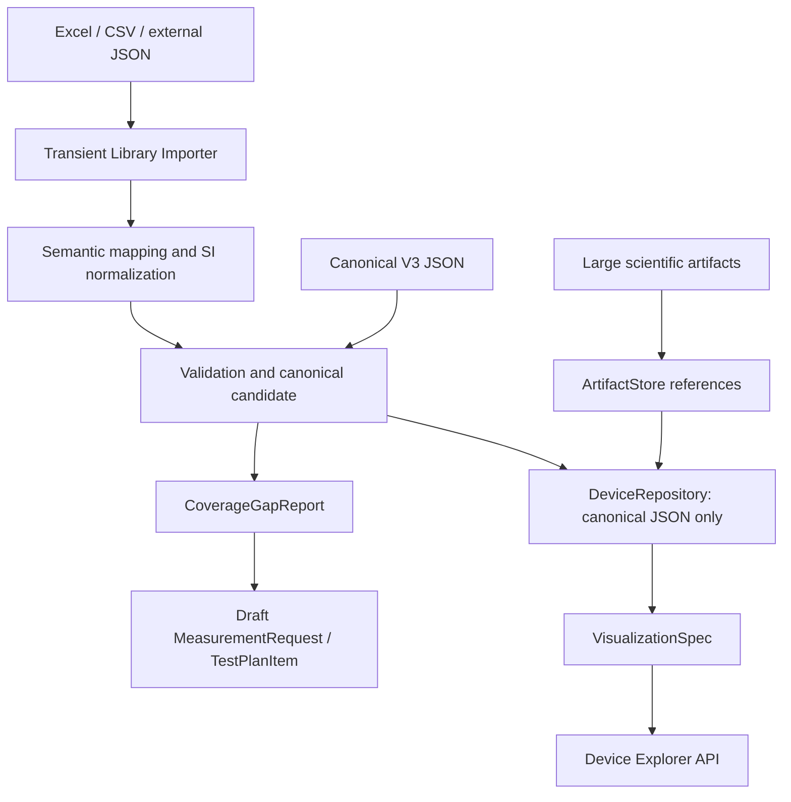

# Usage: query, export, import, migration, measurement packages, Device Explorer and DAB losses

Run all examples from the repository root. The package is installed with
`python -m pip install -e '.[dev]'`; MATLAB export needs `.[matlab]` (SciPy), library import `.[library]`
(openpyxl), candidate import `.[candidates]` (PyYAML) and waveform loading `.[waveforms]` (h5py).

## Install and test

```bash
python3 -m venv .venv
source .venv/bin/activate
python -m pip install -e '.[dev]'
pytest -q
ruff check src tests scripts
ruff format --check src tests scripts
```

For runtime only, use `pip install -e .`. Source datasets stay in the checkout and are not bundled into the
Python wheel.

## Query and export

```python
from aipe_devices.repository.json_repository import JsonDeviceRepository
from aipe_devices.services.coverage import CoverageAnalyzer
from aipe_devices.exporters.plecs import PlecsExporter

repo = JsonDeviceRepository("data/canonical")
device = repo.get("wolfspeed_c2m0025120d")
print(device.identity.part_number)
print(CoverageAnalyzer().analyze(device))
print([d.device_id for d in repo.search("C2M0025")])
xml = PlecsExporter().export(device, "data/derived/C2M0025120D.xml")
```

```python
from aipe_devices.exporters.json import JsonExporter
from aipe_devices.domain.device import PowerSemiconductorDevice
from aipe_devices.exporters.matlab import MatlabExporter

text = JsonExporter().export(device)
assert PowerSemiconductorDevice.model_validate_json(text) == device
MatlabExporter().export(device, "data/derived/C2M0025120D.mat")
```

## Import PLECS and migrate

```python
from aipe_devices.importers.plecs import PlecsImporter
from aipe_devices.schema.enums import Technology
from aipe_devices.services.validation import validate_device

device = PlecsImporter().load(
    "data/raw/wolfspeed/SiC/Wolfspeed/MOSFET with Diode/MOSFETs/C2M0025120D.xml",
    technology=Technology.SIC_MOSFET,
    integration="discrete",
)
report = validate_device(device)
report.raise_for_errors()
```

Technology and integration come from the known catalogue because XML alone does not establish material or
internal module topology. No ratings, gate voltages, die counts or datasheet conditions are guessed from
part numbers/comments.

```bash
aipe-devices import-wolfspeed data/raw/wolfspeed data/canonical --report docs/migration-report.json
aipe-devices migrate-legacy v1 legacy/v1 /tmp/aipe-v1-migration
aipe-devices migrate-legacy v2 legacy/v2 /tmp/aipe-v2-migration
```

Reimporting the official corpus verifies identical records; changed existing records raise instead of being
overwritten. Review alternative legacy migrations in separate repositories. [Migration details](migration.md)
explain V2 information loss.

## Measurement partners

Partners receive a versioned `MeasurementRequest` and submit a `MeasurementPackage` manifest with runs,
source/access metadata and artifact references. Protocol version, sample/lot identity, deskew, probe settings
and processing recipes have dedicated types. No waveform arrays are embedded in device JSON.

```bash
aipe-devices validate-package examples/measurement_package/manifest.json
python scripts/generate_examples.py
```

The example is explicitly **synthetic**, not a device characterization claim. See the
[partner interface](measurement.md), [example request](../examples/measurement_request.json) and
[JSON Schemas](schemas/). Validation checks references, recipes, optional request coverage, artifact paths,
sizes and checksums.

## Library import and Device Explorer

Phase 2 adds transient Excel/CSV/generic JSON import, explicit semantic mapping, coverage gaps and draft
measurement plans, and a renderer-neutral Device Explorer. Canonical JSON takes the direct
schema/engineering-validation path. Ambiguous fields and missing units remain unresolved until an explicit
mapping is provided.



```bash
python -m pip install -e '.[library]'
aipe-devices inspect-import examples/import/device_switching.xlsx --origin synthetic
aipe-devices import-library examples/import/device_switching.xlsx --origin synthetic --output data/derived/demo-library
aipe-devices explore --repository data/derived/demo-library --search DEMO-001
aipe-devices explore --repository data/derived/demo-library --device synthetic_demo_001 --curves
python examples/device_explorer_demo.py
```

The checked-in spreadsheets are tiny, explicitly synthetic tutorial fixtures. Production uploads are never
copied into this repository; the caller's original file is left intact. Import provenance stores filename,
hash, timestamp, version, and row/column conversion locators. Large raw scientific artifacts and the original
Wolfspeed evidence retain their existing storage policy.

See the [Phase-2 guide and examples](phase2.md), [implementation report](phase2-report.md), and
[generated example outputs](../examples/phase2/). The Explorer is an API/CLI foundation; no production GUI,
implicit interpolation, or laboratory execution is included.

## DAB loss evaluation, screening and measurement requests

Version 3.1.0 adds a working `LossEvaluator` for a dual-active-bridge switch position, N-D tensor
interpolation with an explicit operating-envelope policy (PLECS guard rows dropped, extrapolation only on
request and flagged), Cauer/Foster thermal services with an electro-thermal fixed point, reviewable datasheet
candidate records under `data/candidates/`, an evidence-tiered device screening and prioritised laboratory
measurement requests. All of it consumes actual converter stress from the AIPE waveform summary (or the HDF5
waveform) and reports every unavailable quantity instead of estimating it.

```bash
aipe-devices dab-losses --device wolfspeed_c3m0075120k --summary runs/dab-l1-nominal-ic/summary.json --switch S1 --tj 398.15 --vdc 800 --fsw 100e3 --rg-on 2 --rg-off 2 --rth-cs 0.1 --rth-sa 0.5
aipe-devices dab-screen --summary runs/dab-l1-nominal-ic/summary.json --rth-cs 0.1 --rth-sa 0.5
aipe-devices measurement-requests --device wolfspeed_c3m0075120k --summary runs/dab-l1-nominal-ic/summary.json --switch S1 --tj 398.15 --vdc 800 --fsw 100e3 --rg-on 2 --rg-off 2
aipe-devices import-candidates data/candidates/sic-dab-shortlist-2026-10-21.yaml --output data/candidates/records
```

`runs/dab-l1-nominal-ic/summary.json` is the summary written by an `aipe-sim dab run` of
[AIPE-Simulation-Skills](https://github.com/FulongLi/AIPE-Simulation-Skills); the outputs generated from the
nominal run are checked in under [`examples/dab/`](../examples/dab/).

For the nominal 10 kW run (800 V -> 400 V, 100 kHz) the primary C3M0075120K position evaluates to 10.4 W
conduction + 5.95 W turn-off at 125 degC with ZVS turn-on, and the secondary C3M0030090K position to
13.9 W + 5.8 W. Candidate records are unreviewed datasheet transcriptions linked to canonical records where
both exist; they never enter `data/canonical/`. See [the DAB guide](dab-loss-screening.md),
[generated outputs](../examples/dab/) and [candidate rules](../data/candidates/README.md).
